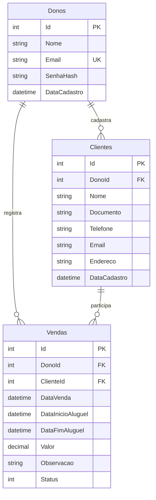

# Starlink System — banco de dados (Projeto de Extensão)

## 1. Escopo e tecnologia

O Starlink System gerencia proprietários da aplicação, clientes e operações de venda/locação. O backend ASP.NET Core .NET 10 usa Entity Framework Core 10 e o provedor SQLite. O arquivo local **Backend/starlink.db** armazena os dados persistentes de desenvolvimento; não é versionado.

Esta entrega preserva as duas migrations existentes, cria proteções adicionais de integridade, fornece um instalador PowerShell e uma ferramenta de auditoria somente de leitura. Não inclui dados reais de usuários, pagamentos processados nem banco publicado na nuvem.

## 2. Modelo entidade-relacionamento



**Cardinalidades:** cada Dono possui zero ou muitos Clientes e Vendas. Cada Cliente pertence a um Dono e possui zero ou muitas Vendas. Cada Venda referencia exatamente um Dono e um Cliente.

## 3. Dicionário de dados

### Donos

| Campo | Tipo C# | Obrigatoriedade | Restrição |
| --- | --- | --- | --- |
| Id | int | Sim | PK, autoincremento |
| Nome | string | Sim | Máx. 150 caracteres |
| Email | string | Sim | Máx. 150; índice único |
| SenhaHash | string | Sim | Hash de senha; não é senha em texto puro |
| DataCadastro | DateTime | Sim | Data do registro |

O endpoint de registro normaliza o e-mail para minúsculas antes de persistir. A senha é processada por `PasswordHasher<Dono>`. Não gravar credenciais reais nos scripts ou migrations.

### Clientes

| Campo | Tipo C# | Obrigatoriedade | Restrição |
| --- | --- | --- | --- |
| Id | int | Sim | PK, autoincremento |
| DonoId | int | Sim | FK → Donos.Id |
| Nome | string | Sim | Máx. 150 |
| Documento | string | Sim | CPF/CNPJ, máx. 20 |
| Telefone | string? | Não | Máx. 20 |
| Email | string? | Não | Máx. 150 |
| Endereco | string? | Não | Máx. 250 |
| DataCadastro | DateTime | Sim | Data do registro |

Índice composto **UNIQUE (DonoId, Documento)**: o mesmo documento não pode ser duplicado para o mesmo proprietário; pode existir em carteiras de proprietários diferentes. O controller remove a pontuação e valida CPF/CNPJ.

### Vendas

| Campo | Tipo C# | Obrigatoriedade | Restrição |
| --- | --- | --- | --- |
| Id | int | Sim | PK |
| DonoId | int | Sim | FK → Donos.Id |
| ClienteId | int | Sim | FK → Clientes.Id |
| DataVenda | DateTime | Sim | Registro da operação |
| DataInicioAluguel | DateTime | Sim | Início |
| DataFimAluguel | DateTime? | Não | Fim, se aplicável |
| Valor | decimal | Sim | Deve ser maior que zero |
| Observacao | string? | Não | Máx. 300 |
| Status | StatusVenda | Sim | Ativa=0; Finalizada=1; Cancelada=2 |

**Regra atual de negócio:** `DataFimAluguel != null` representa um aluguel; `null` representa uma venda. Isso é uma convenção do sistema atual, não uma tabela separada de contratos.

## 4. Integridade e isolamento

- PKs e FKs asseguram existência dos registros relacionados.
- Exclusão é restrita para clientes com vendas e para relacionamentos com proprietários.
- Índices únicos: `Donos.Email` e `Clientes(DonoId, Documento)`.
- A API lê `DonoId` do JWT e filtra clientes e vendas por proprietário.
- A migration `AddBancoIntegrityGuards` cria gatilhos SQLite em INSERT/UPDATE de Vendas para exigir **Valor > 0**, datas coerentes e mesmo DonoId do cliente associado.
- Outro gatilho impede a transferência direta de Cliente para outro Dono por UPDATE de `DonoId`.
- Validações adicionais da classe `Venda` retornam erros HTTP 400 em operações inválidas recebidas pela API.

Os gatilhos são complementares à autorização da API: **não substituem JWT e o controle de acesso por usuário**. Em caso de alterações futuras de tabelas, rever também os gatilhos, porque são artefatos SQL específicos do SQLite.

## 5. Histórico das migrations

1. `20260901143358_InitialCreate` — tabelas iniciais Clientes e Vendas.
2. `20260901160137_AddAutenticacaoDono` — adiciona Donos, DonoId, índices e relacionamentos.
3. `20261110203000_AddBancoIntegrityGuards` — gatilhos de integridade e isolamento.

O histórico aplicado é registrado em `__EFMigrationsHistory`. As migrations antigas não foram reescritas para não comprometer bancos existentes.

**Atenção a bases antigas:** se um arquivo SQLite anterior a `AddAutenticacaoDono` já possui clientes/vendas, o preenchimento histórico de `DonoId=0` pode impedir a criação das FKs. É necessário analisar os dados e realizar uma migração assistida com backup antes de atualizar. **Não apagar a base para contornar o erro.**

## 6. Instalação / atualização local

Pré-requisitos: SDK .NET 10, PowerShell, NuGet acessível. Para inspeção adicional, Python 3.

Com a API parada e dentro da raiz do repositório:

```powershell
git switch develop
git pull --ff-only origin develop
.\scripts\setup-database.ps1
```

O instalador `setup-database.ps1`:
1. Restaura a ferramenta `dotnet-ef` na versão declarada em `.config/dotnet-tools.json`.
2. Se existir `Backend/starlink.db` e não houver WAL/SHM pendente, cria backup com carimbo de data/hora em `Backend/backups/`.
3. Executa `dotnet ef database update` usando uma fábrica design-time própria, sem precisar revelar a chave JWT.
4. Mantém registros existentes e aplica somente migrations ausentes.

Alternativa manual:

```powershell
dotnet tool restore
dotnet tool run dotnet-ef database update --project Backend/Starlink.Api.csproj --startup-project Backend/Starlink.Api.csproj
```

**Importante:** o ambiente `Testing` usa seu próprio SQLite em memória e não deve receber dados reais. O banco do desenvolvimento persistente é `Backend/starlink.db`.

## 7. Inspeção do banco

```powershell
py -3 scripts/verify_database.py Backend/starlink.db
```

O auditor abre o SQLite em modo somente leitura, verifica `integrity_check`, `foreign_key_check`, tabelas, migrations, gatilhos, proprietários divergentes e operações com valores ou períodos inválidos. Retorna erro se houver inconsistências. Não cria, corrige nem exclui registros.

Para listar as migrations disponíveis:

```powershell
dotnet tool run dotnet-ef migrations list --project Backend/Starlink.Api.csproj --startup-project Backend/Starlink.Api.csproj --no-connect
```

## 8. Rotina de testes do banco

- Os testes `DatabaseMigrationsTests` executam migrations em um SQLite isolado na memória e validam a rejeição de uma venda associada a cliente de outro dono.
- A CI restaura `dotnet-ef`, aplica o esquema em banco descartável no runner e executa a auditoria Python.
- Evidências recomendadas para o relatório: comando de migrations; auditoria OK; esquema das três tabelas; PR revisado; captura dos fluxos de cadastro/clientes/vendas usando API real.

## 9. Persistência, backup e deploy

O banco `.db` e seus arquivos `-wal`/`-shm` são ignorados pelo Git. **Não enviar arquivos com usuários, senhas, hashes ou dados pessoais ao repositório público.**

Em produção, SQLite só é apropriado com armazenamento realmente persistente, backup consistente e política de concorrência adequada. Sistemas serverless com disco efêmero (como Vercel Functions) não servem como armazenamento primário do SQLite.

O frontend é Blazor Interactive Server e o backend é ASP.NET Core; ambos precisam de hospedagem compatível com .NET e execução contínua. Para um deploy de maior porte, avaliar PostgreSQL gerenciado e uma migração planejada de provedor (as migrations SQLite não são portáveis automaticamente).

**Não aplicar migrations automaticamente em produção em cada inicialização do serviço:** realizar backup, executar processo de atualização controlado e testar rollback.

## 10. Limitações atuais e propostas futuras

- O sistema ainda não possui tabelas próprias para equipamentos Starlink, estoques, pagamentos, parcelas, agendamentos ou auditoria de eventos.
- `Vendas` une venda e aluguel por uma regra baseada na data final; essa abordagem pode evoluir após alinhamento com os requisitos.
- O SQLite não oferece suporte nativo integral a `decimal`; cuidados adicionais são necessários para cálculos e relatórios financeiros.
- Não há estratégia implementada de LGPD, rotinas de expurgo, backups agendados ou replicação de produção nesta entrega.
- A implantação cloud e a escolha de armazenamento definitivo ocorrerão após a revisão do frontend e da infraestrutura.
